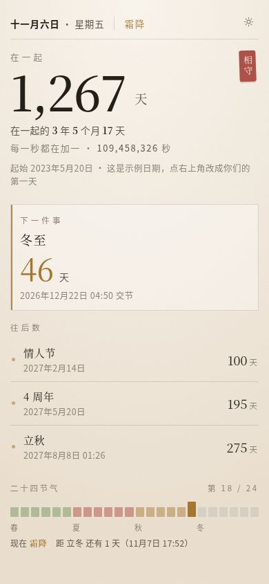
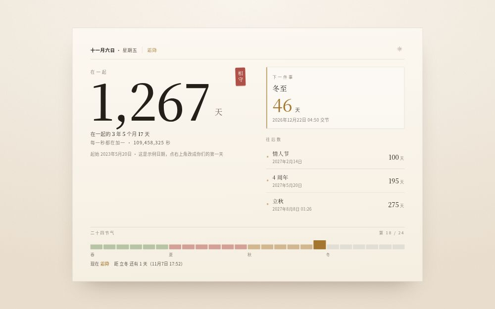

# 纪念日小窗

把「在一起第几天」做成一个放在桌面的小卡片：安卓桌面小组件 + 单文件网页版 + Windows 桌面小窗三套实现，同一套视觉。

<p align="center">
  
  
</p>

## 功能

- **天数**：按起止日期算「第 N 天」与下个纪念日倒数，日期变化/时区变化/时间修改会自动刷新
- **暂停与恢复**：可以暂停计时（天数停在暂停那天），恢复后按原始起点接着走，即暂停期间的天数不计入
- **天气**：当前温度与天气状况，点击可手动刷新（可选，需要联网权限）
- **每日一句**：调用智谱 GLM 生成当天的一行文案，API Key 存在本机 SharedPreferences，不写进代码
- **相框**：可以从相册选一张照片放进卡片，也可随时回退到无相框版
- **多皮肤**：纸张 / 粉 / 夜间等多套样式，桌面小组件自带多套 layout

## 三套实现

| 形态 | 位置 | 说明 |
| --- | --- | --- |
| 安卓桌面小组件 | `android/` | `WidgetProvider` + 多套 `widget_style_*.xml`；AppWidget 直接绘制，不常驻后台服务 |
| 网页版 | `纪念日小窗.html` | 单文件，双击即用，含设置面板（名字、日期、样式） |
| Windows 桌面 | `桌面小窗.vbs` | 用系统脚本把网页以无边框小窗贴到桌面 |

## 构建（安卓）

需要 JDK 17、Android SDK（build-tools 34.0.0、platform android-35），**不需要 Gradle**：

```bash
cd android
./build.sh          # 产物在同一项目目录 纪念日小窗.apk
```

环境变量可覆盖默认路径：

```bash
ANDROID_SDK=/path/to/sdk JDK_HOME=/path/to/jdk ./build.sh
```

签名用自签 debug key，仓库不含 `.keystore`（缺失时脚本自动生成）。换机重装前先卸载旧版本，否则签名不一致会装不上。

## 关于 API Key

`Llm.java` 只读取 `SharedPreferences` 里的 `apiKey`，仓库里没有任何硬编码密钥。要启用「每日一句」，自己在应用设置里填智谱的 key；不填则该功能不可用，其余功能不受影响。

## License

MIT，见 `LICENSE`。
